# Route-53-Geolocation-Policy-for-Elastic-Load-Balancing
## Geolocation routing lets you choose the resources that serve your traffic based on the geographic location of your users, meaning the location from which DNS queries originate.
### For this lab, I will use three different region 
1. ap-southeast-1(Singapore) for the users from ASIA, 
2. eu-west-2(London) for the users from Europe, 
3. us-west-1(North California) for the users from Amarica


### For ap-southeast-1 (Singapore Region)
#### Create VPC with Cidr Block 10.10.0.0/16
#### Create two private subnets and two public subnets
#### Create internet gateway attached with VPC
#### Create a default route and associate two public subnets to main route table
#### Create a custom route table for two private subnets
#### Create a natgateway for private subnets to conect internet
#### Create a default route and associate two private subnets to custom route table
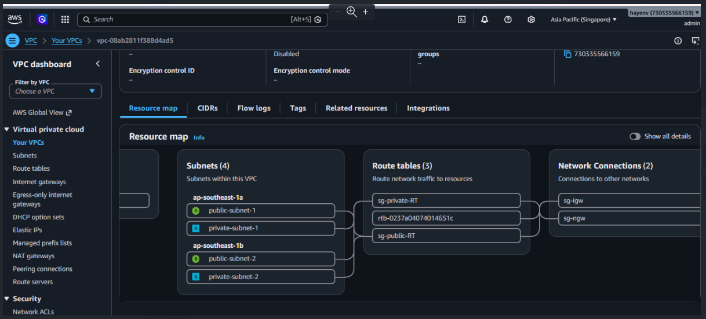

#### Create loadbalancer security group that add the rules ssh, http, https in inbound rules and add port 80 to web server security group in outbound rule

#### Create Web-server Security group that add the rules ssh and http from source loadbalancer security group and also https from source loadbalancer security group

#### Create two web server in two private subnets with userdata

### For WebServer 1
```

#!/bin/bash

apt-get update -y
apt-get install -y apache2

systemctl enable apache2
systemctl start apache2

echo "<html><body><h1>Hello! This is SINGAPORE WEB SERVER 1</h1></body></html>" > /var/www/html/index.html

```

#### For WebServer 2
```

#!/bin/bash

apt-get update -y
apt-get install -y apache2

systemctl enable apache2
systemctl start apache2

echo "<html><body><h1>Hello! This is SINGAPORE WEB SERVER 2</h1></body></html>" > /var/www/html/index.html

```

#### Create Bastionhost server for connect with private two web servers

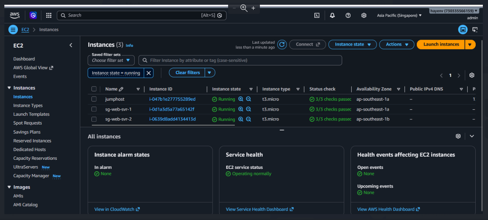

#### Want to see app with flag like Singapre Flag, so edited in /var/www/html/index.html
```

&#127480;&#127468; Hello! This is SINGAPORE WEB SERVER 1/2 &#127480;&#127468;

```

#### Create Target Group with these two servers

#### Create LoadBalancer with listener rule http 80 and https 443
### For https 443, need to create certificate
#### Domain name is hayko.ink from namecheap
#### in Route 53, create public hosted zone and then create Record name www.hayko.ink with A type,region is Singapore,routing is Geolocation

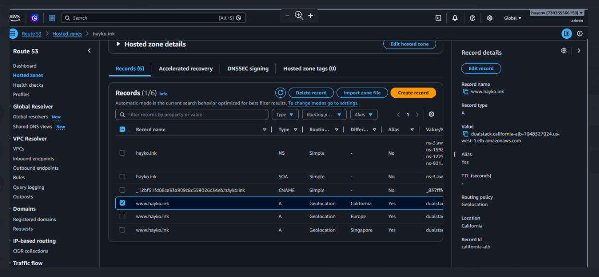

#### Create certificate in ACM 

#### domain name is from namecheap, so need to add the values of record name in namecheap like

```
1. Log in to Namecheap → Domain List → click Manage next to hayko.ink.
2. Find the Nameservers section and change Namecheap BasicDNS to Custom DNS.
Enter the 4 Route 53 name servers, one per line, without the trailing dot:

ns-3.awsdns-00.com
ns-1598.awsdns-07.co.uk
ns-1229.awsdns-25.org
ns-921.awsdns-51.net

```

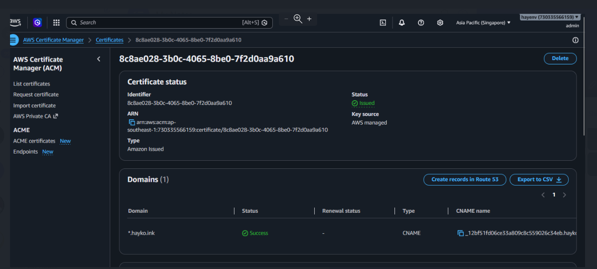

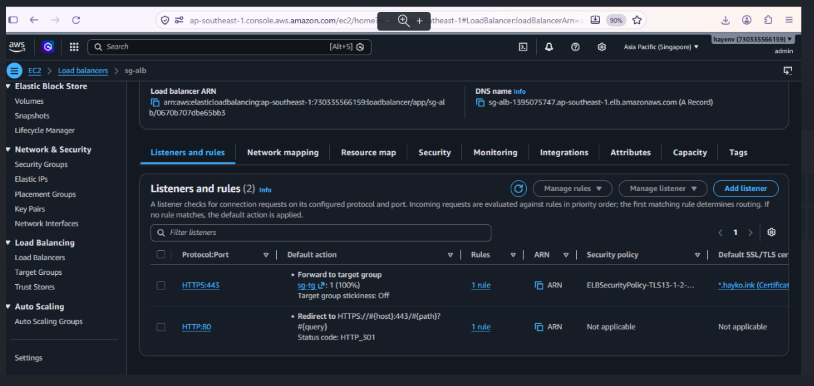

#### Test nslookup www.hayko.ink 8.8.8.8

#### Run www.hayko.ink with VPN Singapore

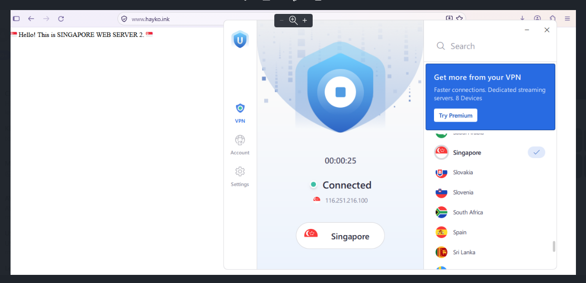

#### For eu-west-2(London Region), create resources according Singapore Region and run

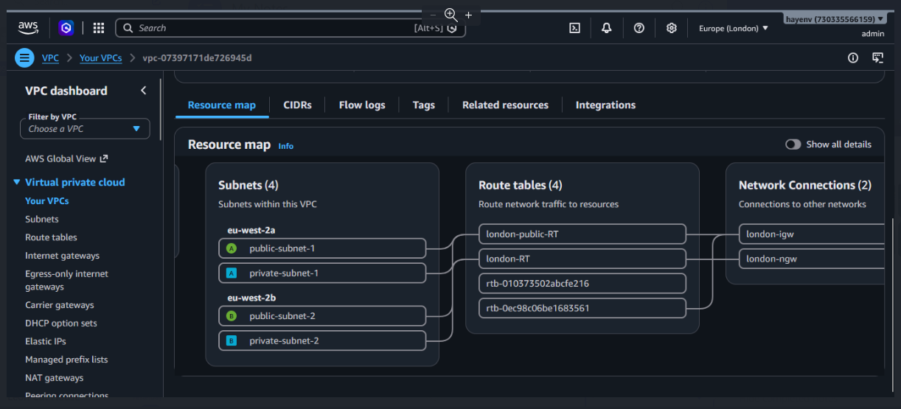

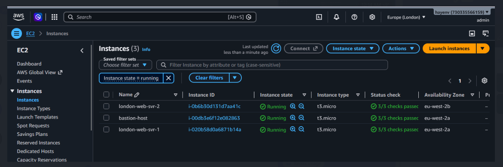

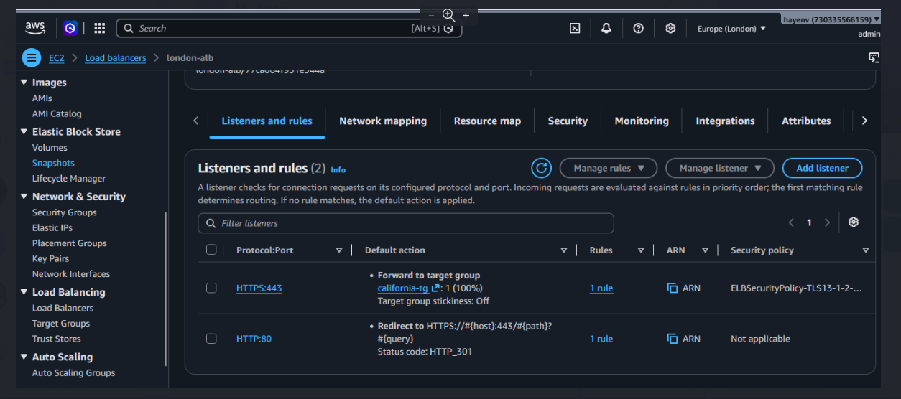

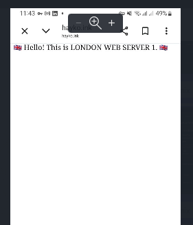

#### For us-west-1(N.California Region), create resources according Singapore Region and run

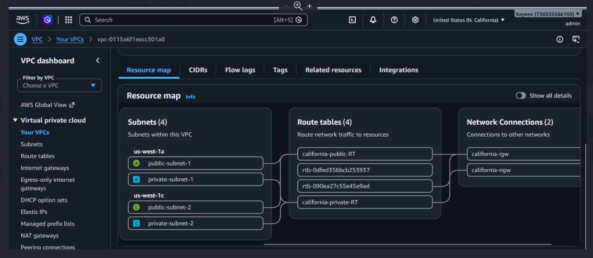

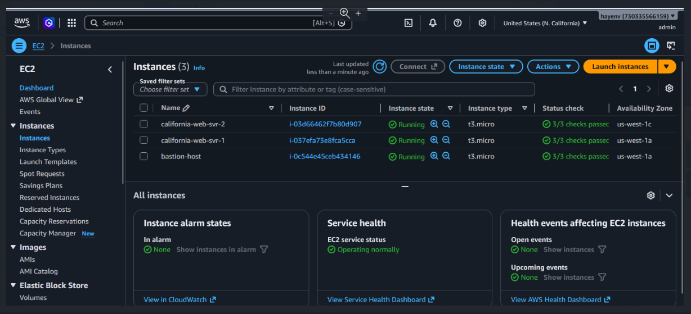

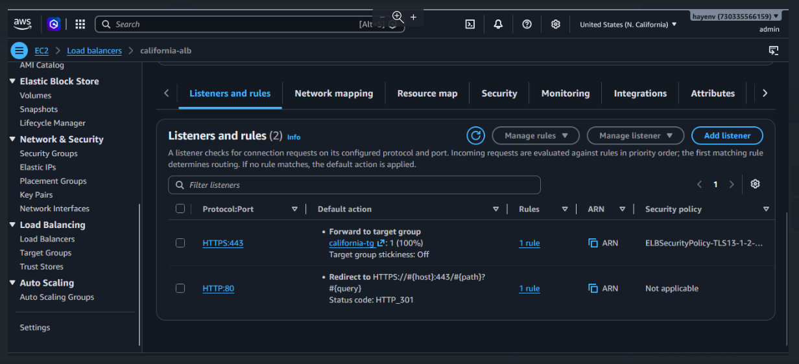

### if error face
```
#for checking userdata
TOKEN=$(curl -X PUT "http://169.254.169.254/latest/api/token" \
  -H "X-aws-ec2-metadata-token-ttl-seconds: 21600")

curl -H "X-aws-ec2-metadata-token: $TOKEN" \
  http://169.254.169.254/latest/user-data

#in window, test in command prompt
nslookup www.hayko.ink 8.8.8.8
```


